

# COSMOS 🌌

### AI와 함께 사고 과정을 성장시키는 알고리즘 학습 플랫폼

단순히 정답을 맞히는 것을 넘어, 
문제 접근 방식과 사고 과정까지 학습할 수 있도록 돕습니다.

 

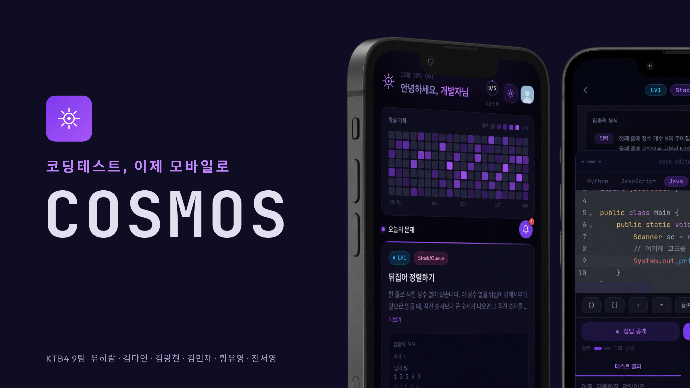

 

[서비스 시연 영상](https://youtu.be/vs9Enw-Xe-4) ·
[Frontend](https://github.com/100-hours-a-week/KTB4-9th-FE) ·
[Backend](https://github.com/100-hours-a-week/KTB4-9th-BE) ·
[AI](https://github.com/100-hours-a-week/KTB4-9th-AI) ·
[Cloud](https://github.com/100-hours-a-week/KTB4-9th-Cloud)

 

## 프로젝트 소개

**COSMOS**는 알고리즘 문제의 정답뿐만 아니라 사용자가 문제를 해결하기 위해 구성한 **접근 방식과 사고 과정**까지 함께 학습할 수 있는 플랫폼입니다.

기존 알고리즘 학습에서 경험할 수 있는 다음과 같은 한계를 해결하고자 시작했습니다.

- 문제를 읽어도 어떤 방식으로 접근해야 할지 알기 어려운 문제
- 정답 코드를 확인해도 풀이가 만들어지는 과정을 이해하기 어려운 문제
- 혼자 문제를 풀면서 자신의 사고 과정이 올바른지 확인하기 어려운 문제
- 꾸준한 학습 동기와 다른 사용자와의 경쟁 경험이 부족한 문제

COSMOS에서는 사용자가 자연어로 풀이 방법을 먼저 정리하고, AI 피드백과 단계별 힌트를 바탕으로 사고를 보완한 뒤 실제 코드 작성과 채점까지 이어갈 수 있습니다. 또한 매일 열리는 **데일리 배틀**, 사용자별 학습 기록, 랭킹과 실시간 알림을 통해 지속적인 학습 경험을 제공합니다.

 

## 개발 인원 및 기간

- 개발 기간: **2026.08 ~ 현재**
- 개발 인원: **총 6명**

| 분야 | 인원 | 담당 |
| :---: | :---: | :--- |
| Backend | 2명 | API, 인증, 문제·채점·배틀 도메인, 비동기 처리 |
| AI | 2명 | 문제 생성·검증, 서술형 풀이 평가, LLMOps |
| Cloud | 2명 | AWS 인프라, 컨테이너 배포, CI/CD, 모니터링 |
| Frontend | - | 팀 내 바이브 코딩으로 개발 |

 

## 주요 기능

| 기능 | 설명 | 화면 |
| :--- | :--- | :---: |
| **홈 · 학습 기록** | 잔디 형태의 학습 기록과 오늘의 문제를 한눈에 확인합니다. 알림, 저장 문제, 랭킹으로 바로 이동할 수 있습니다. | 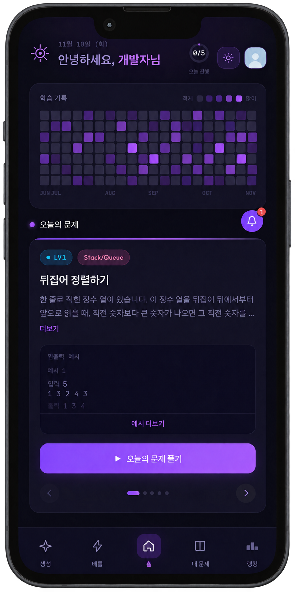 |
| **AI 맞춤 문제 생성** | 난이도와 알고리즘 카테고리를 선택해 맞춤 문제를 생성합니다. 생성 문제는 정적 검증, 중복·모순 검사와 Judge0 실행 검증을 통과한 뒤 제공됩니다. | 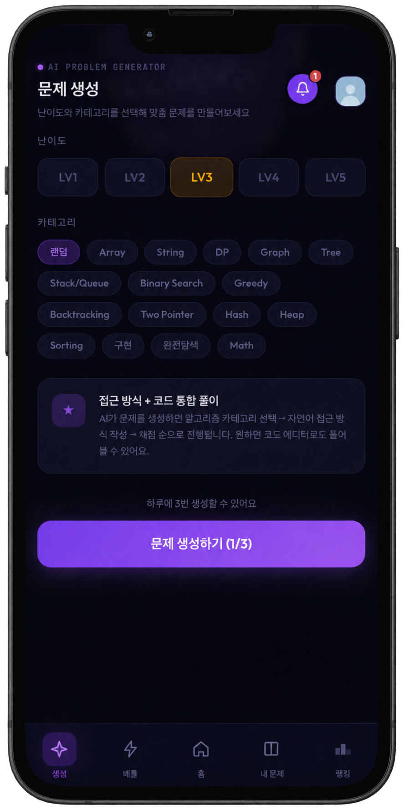 |
| **자연어 접근법 작성** | 코드를 작성하기 전에 문제의 핵심 조건, 사용할 알고리즘과 구현 순서를 자연어로 구조화해 제출합니다. | 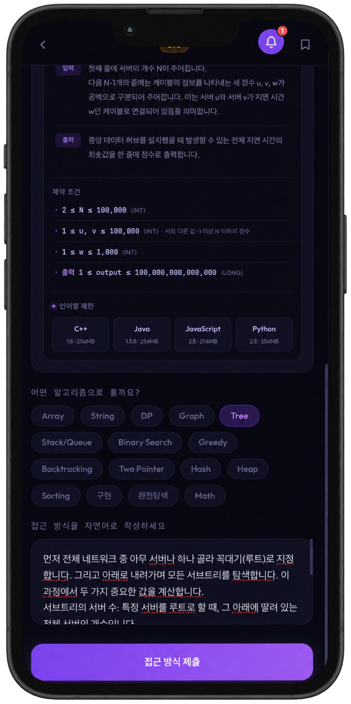 |
| **AI 접근법 평가** | 접근 방식, 카테고리, 핵심 키워드와 설명 순서를 평가하고 점수 및 구체적인 피드백을 제공합니다. 완료 결과는 SSE 알림으로 실시간 전달됩니다. | 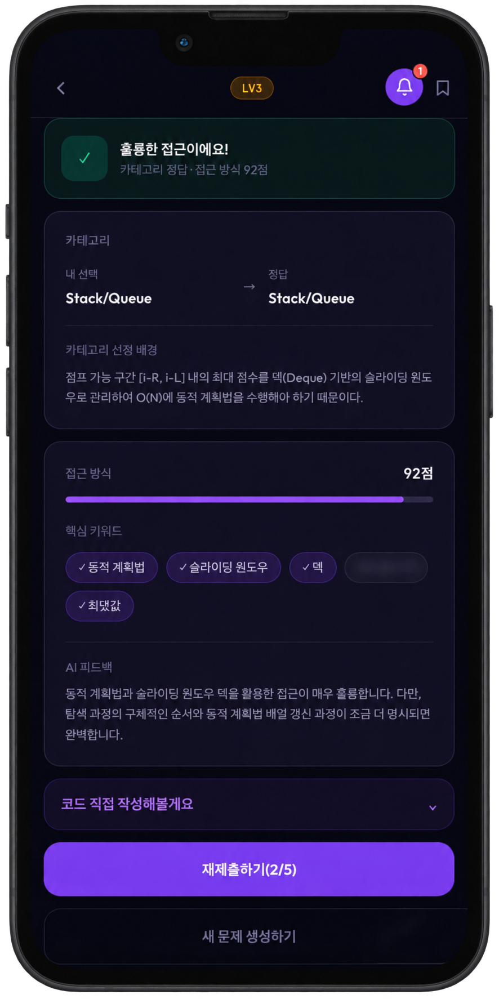 |
| **코드 작성 · 단계별 힌트** | CodeMirror 에디터에서 Python, Java, JavaScript, C++ 코드를 작성합니다. 막히는 경우 단계별 힌트나 정답 공개를 통해 풀이를 이어갈 수 있습니다. | 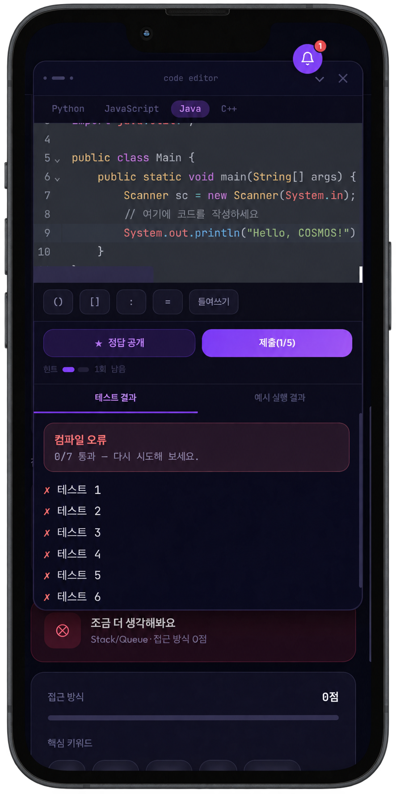 |
| **코드 자동 채점** | Judge0를 통해 사용자 코드를 실행하고 테스트 케이스별 통과 여부, 컴파일 오류 및 실행 결과를 제공합니다. |  |
| **데일리 배틀 · 문제 풀이** | 정해진 시간 동안 모든 사용자가 동일한 세 문제의 출력값을 작성합니다. 남은 시간과 제출 마감 시간을 실시간으로 확인할 수 있습니다. | 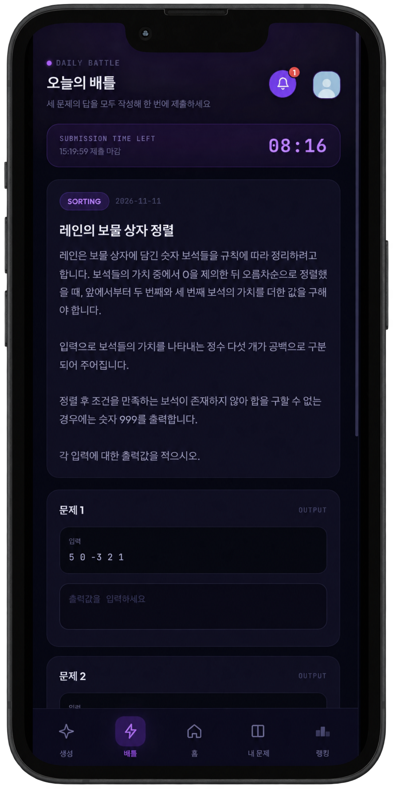 |
| **데일리 배틀 · 결과 대기** | 제출 후 배틀이 끝날 때까지 다른 참가자의 답과 중간 결과를 가리고 결과 공개 시점을 안내합니다. | 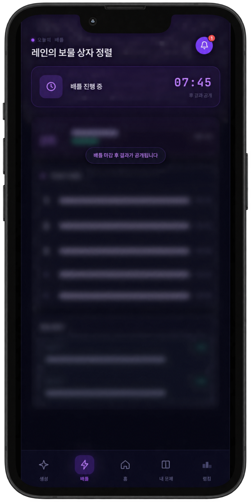 |
| **데일리 배틀 · 결과 및 랭킹** | 정답 여부와 풀이 시간을 바탕으로 TOP 5 및 개인 순위를 집계하고, 케이스별 정답과 내 답안을 함께 제공합니다. | 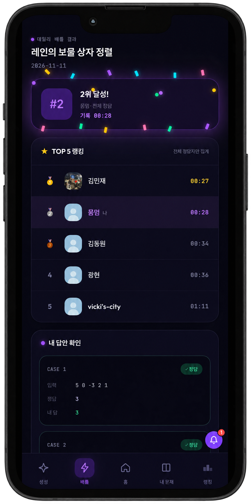 |
| **저장 문제 · 활동 기록** | 관심 문제를 저장하고 풀이 및 배틀 참여 이력을 관리합니다. 난이도·카테고리별 포인트로 학습 상태와 전체 랭킹을 확인합니다. | 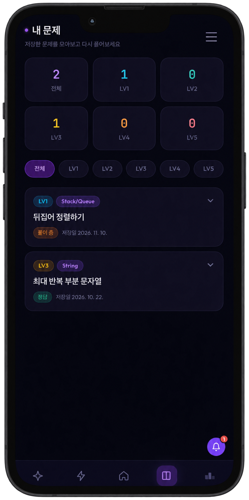 |

 

## Backend 소개

- Spring Boot 기반 REST API 서버로 인증, 문제, 접근법, 코드 제출, 데일리 배틀, 랭킹 및 알림 기능을 제공합니다.
- Spring Security와 JWT를 활용해 Stateless 인증·인가를 처리하고 Kakao OAuth 로그인을 지원합니다.
- Judge0와 연동하여 Python, Java, JavaScript, C++ 코드를 채점합니다.
- RabbitMQ Worker를 활용하여 AI 평가와 데일리 배틀 채점을 비동기로 처리합니다.
- Transactional Outbox, 작업 선점 및 Lease 기반 처리로 메시지 유실과 중복 처리를 방지합니다.
- Redis로 평가 완료 이벤트를 서버 간 전달하고 SSE로 사용자에게 실시간 알림을 제공합니다.
- Prometheus, Grafana, Loki, Pyroscope, Sentry를 통해 메트릭, 로그, 프로파일과 오류를 관측합니다.

 

## 사용 기술 및 Tools

### Backend

  
  
  
  
  
  

### AI

  
  
  
  
  
  

### Data & Messaging

  
  
  
  
  
  

### External Service & Observability

  
  
  
  
  
  
  

### Test & Deployment

  
  
  
  
  
  
  
  

 

## 서비스 시연 영상

 

[▶️ COSMOS 서비스 시연 영상 보기](https://youtu.be/vs9Enw-Xe-4)

 

## 서버 구조

서버 구조 보기

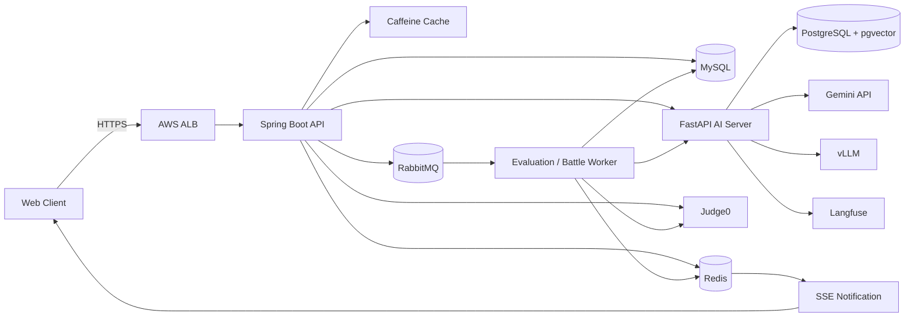

| 영역 | 역할 |
| :--- | :--- |
| Spring Security | JWT 검증, Kakao OAuth 로그인, API 접근 제어 |
| Spring API | 문제·풀이·배틀·랭킹·알림 비즈니스 로직 |
| RabbitMQ Worker | AI 평가와 배틀 채점의 비동기 실행 |
| Transactional Outbox | 데이터 변경과 이벤트 발행 정보의 원자적 저장 |
| Redis & SSE | 평가 완료 이벤트의 서버 간 전달과 실시간 알림 |
| AI Server | 문제 생성·검증, 배틀 문제 생성, 서술형 풀이 평가 |
| Judge0 | 레퍼런스 코드 검증과 사용자 제출 코드 채점 |

 

## AI 문제 생성 구조

AI 문제 생성 파이프라인 보기

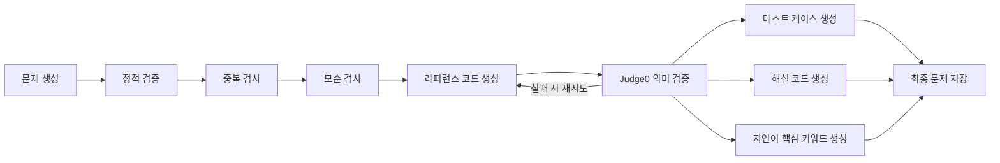

- LangGraph로 문제 생성과 검증 단계를 구성합니다.
- 동일 카테고리 문제를 임베딩한 뒤 코사인 유사도로 중복을 제거합니다.
- 레퍼런스 코드를 Judge0에서 실행하여 공개 예시와 히든 테스트 출력을 검증합니다.
- 생성과 검증을 통과한 문제만 Spring 서버로 전달합니다.
- PostgreSQL Advisory Lock으로 다중 컨테이너 환경에서도 배치가 한 곳에서만 실행되도록 합니다.

 

## 구현 기능

구현 기능 보기

| 도메인 | 구현 기능 |
| :--- | :--- |
| 인증 | Kakao OAuth 로그인, JWT Access/Refresh Token 발급·갱신, 로그아웃 |
| 문제 | 문제 목록·상세, 일일 문제, 맞춤형 문제 선택, 문제 재고 관리 |
| 접근법 | 자연어 접근법 작성·조회, AI 비동기 평가 및 결과 조회 |
| 힌트 | 문제별 단계형 힌트 조회 |
| 코드 제출 | Python·Java·JavaScript·C++ 제출 및 Judge0 채점 |
| 데일리 배틀 | 배틀 생성·참여·제출·포기·결과·TOP 랭킹 |
| 배틀 채점 | RabbitMQ 비동기 채점, 작업 선점, Lease, Timeout 및 복구 |
| 랭킹 | 전체·개인 랭킹, 난이도·카테고리별 포인트 집계 |
| 저장 문제 | 문제 저장·해제 및 저장 목록 조회 |
| 활동 기록 | 문제 풀이와 사용자 활동 기록 조회 |
| 실시간 알림 | 평가 완료 알림, 읽음 처리, SSE 실시간 전송 |
| AI 문제 생성 | 일반·데일리·배틀 문제 생성, 중복·모순·실행 검증 |
| 테스트 | 단위·통합·동시성·프로세스 재시작 복구 테스트, k6 부하 테스트 |
| 관측성 | Prometheus, Grafana, Loki, Pyroscope, Sentry |

 

## CI/CD 구조

CI/CD 구조 보기

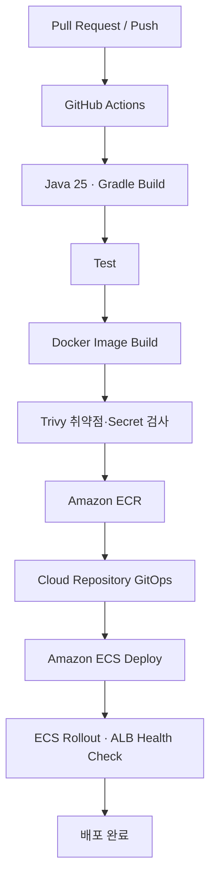

1. Pull Request 또는 대상 브랜치 Push를 기준으로 CI를 실행합니다.
2. Java 25 환경에서 Gradle 빌드와 테스트를 수행합니다.
3. Docker 이미지를 빌드하고 Trivy로 취약점과 Secret을 검사합니다.
4. 검증된 이미지를 Commit SHA 기반 태그로 Amazon ECR에 게시합니다.
5. Cloud Repository를 통한 GitOps 방식으로 Amazon ECS에 배포합니다.
6. ECS Rollout 상태와 ALB Target Health를 검증합니다.

 

## Repository

| 구분 | 인원 | Repository |
| :--- | :---: | :--- |
| Frontend | 바이브 코딩 | [KTB4-9th-FE](https://github.com/100-hours-a-week/KTB4-9th-FE) |
| Backend | 2명 | [KTB4-9th-BE](https://github.com/100-hours-a-week/KTB4-9th-BE) |
| AI | 2명 | [KTB4-9th-AI](https://github.com/100-hours-a-week/KTB4-9th-AI) |
| Cloud | 2명 | [KTB4-9th-Cloud](https://github.com/100-hours-a-week/KTB4-9th-Cloud) |

 

### Think deeper, solve better.

**COSMOS**

